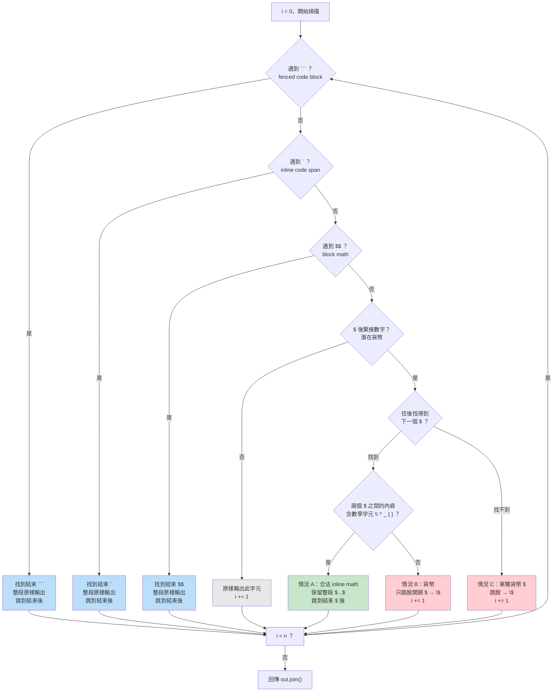

# `escapeCurrency` 跳脫邏輯技術文件

> 日期：2026-07-31  
> 對應程式碼：`frontend/components/markdown-content.tsx`  
> 相關規格：`docs/superpowers/specs/2026-07-30-markdown-katex-rendering-design.md`

## 摘要

`escapeCurrency` 是一個字串前處理函式，在 Markdown 內容送進 `remark-math` 之前先掃描一遍，把**貨幣金額**（如 `$100`）的 `$` 跳脫成 `\$`，避免 `remark-math` 把它誤當成 inline math 的分隔符；同時保留**真正的數學公式**（如 `$2^n$`）不動。

---

## 1. 問題背景

### `remark-math` 的配對機制

`remark-math` 的 inline math 規則：兩個未跳脫的 `$` 之間的內容就是 inline math。

```
$E = mc^2$        → remark-math 配對 → KaTeX 渲染成數學 ✓
```

### 貨幣金額的衝突

貨幣寫法 `$100 + $100 = $200` 有三個 `$`，`remark-math` 會把第 1 個和第 2 個配對：

```
$100 + $100 = $200
^       ^          ← remark-math 把這兩個配對
"100 + "           ← 內容被當成數學送進 KaTeX → 渲染錯誤 ✗
```

### 解法

在 `remark-math` 看到之前，先把貨幣的 `$` 跳脫成 `\$`。`remark-math` 看到 `\$` 就知道是字面上的 `$`（不是 delimiter），不會拿來配對。

```
\$100 + \$100 = \$200   → remark-math 不配對 → 顯示 $100 + $100 = $200 ✓
```

---

## 2. 渲染管線總覽

`escapeCurrency` 位於渲染管線的最前端，在所有 remark/rehype plugin 之前：

```
┌─────────────┐    ┌──────────────────┐    ┌─────────────┐    ┌────────────────┐    ┌──────────────┐    ┌──────────┐
│  raw content │───▶│  escapeCurrency  │───▶│ remark-gfm  │───▶│  remark-math   │───▶│ rehype-katex │───▶│   HTML   │
│  (string)    │    │  (跳脫貨幣 $)    │    │ (GFM 語法)  │    │ (配對 $...$)   │    │ (KaTeX 排版) │    │ (output) │
└─────────────┘    └──────────────────┘    └─────────────┘    └────────────────┘    └──────────────┘    └──────────┘
                          │
                          ▼
                   \$100 → 字面 $     $2^n$ → 保留，交給 remark-math 配對
```

---

## 3. 演算法流程圖

`escapeCurrency` 用 `while` 迴圈逐字掃描，每個位置依序檢查 4 層條件，**先命中先處理**：



---

## 4. 決策規則表

### 4.1 四層優先檢查

| 優先層 | 條件 | 動作 | 原因 |
|---|---|---|---|
| 第 1 層 | `input.startsWith("```", i)` | 整段 code block 原樣輸出 | code block 內的 `$100` 不該被跳脫 |
| 第 2 層 | `input[i] === "`"` | 整段 code span 原樣輸出 | code span 內的 `$100` 不該被跳脫 |
| 第 3 層 | `input[i] === "$" && input[i+1] === "$"` | 整段 block math 原樣輸出 | `$$` 是明確的 block math 語法，不會跟貨幣混淆 |
| 第 4 層 | `input[i] === "$" && /\d/.test(input[i+1])` | 見下表「情況 A/B/C」 | `$` + 數字才可能是貨幣 |
| 第 5 層 | （以上皆非） | 原樣輸出此字元 | `$x$`、`$E=mc^2$` 等交給 remark-math 原本邏輯 |

> **第 3 層必須在第 4 層之前**，否則 `$$100$$` 會被第 4 層當成 `$` + 數字而誤跳脫。

### 4.2 第 4 層的三種情況

| 情況 | 條件 | 動作 | 範例 |
|---|---|---|---|
| **A** | `$\d` + 有下一個 `$` + 內容**含**數學字元 | 保留整段 `$...$` 不動 | `$2^n$` → `$2^n$` |
| **B** | `$\d` + 有下一個 `$` + 內容**不含**數學字元 | **只跳脫開頭 `$`** → `\$` | `$100 + $` → `\$100 + $` |
| **C** | `$\d` + **沒有**下一個 `$` | 跳脫這個 `$` → `\$` | `$200` → `\$200` |

### 4.3 數學字元定義

```ts
const MATH_CHARS = /[\\^_{}]/;
```

| 字元 | 數學語意 | 範例 |
|---|---|---|
| `\` | LaTeX 指令 | `\frac`, `\sigma`, `\times` |
| `^` | 上標 | `2^10`, `x^2` |
| `_` | 下標 | `S_0`, `d_1` |
| `{` `}` | 分組 | `{1-\gamma}`, `\frac{a}{b}` |

只要兩個 `$` 之間的內容**含有任一個**這些字元，就認定是真正的數學。

---

## 5. 核心設計：為什麼「只跳脫開頭 `$`」？

這是整個演算法最精妙的設計。考慮混合情境：

```
The premium is $5.25 for an option with payoff $max(S_T - K, 0)$.
                ^^^^^                               ^               ^
                貨幣                                數學開頭        數學結尾
```

### 如果跳脫**兩個** `$`（錯誤做法）

```
The premium is \$5.25 for an option with payoff \$max(S_T - K, 0)\$.
                                                  ^                   ^
                                                  被跳脫              被跳脫

→ remark-math 找不到合法的 $...$ 配對
→ max(S_T - K, 0) 不會渲染成數學 ✗
```

### 如果**只跳脫開頭** `$`（正確做法）

```
The premium is \$5.25 for an option with payoff $max(S_T - K, 0)$.
                ^^^^                               ^               ^
                被跳脫                             未跳脫          未跳脫

→ remark-math 看到 $max...$ 是一對未跳脫的 $
→ 正確配對，渲染成數學 ✓
```

### 圖示比較

```
  跳脫兩個 $（✗）                    只跳脫開頭 $（✓）
  ┌─────────────────────┐            ┌─────────────────────┐
  │ \$5.25 ... \$max\$  │            │ \$5.25 ... $max...$ │
  │  ^^^^      ^^^   ^^ │            │  ^^^^      ^^^   ^  │
  │  跳脫      跳脫  跳脫│            │  跳脫      未跳  未跳│
  └─────────────────────┘            └─────────────────────┘
           │                                  │
           ▼                                  ▼
  remark-math 找不到配對              remark-math 配對 $max...$
  max(...) 不渲染 ✗                   max(...) 渲染成數學 ✓
```

---

## 6. 追蹤範例

### 6.1 純貨幣：`$100 + $100 = $200`

| 步驟 | 位置 `i` | 字元 | 命中層 | 條件判斷 | 動作 | 輸出累積 |
|---|---|---|---|---|---|---|
| 1 | 0 | `$` + `1` | 第 4 層 | closeIdx=7, content=`"100 + "` 無數學字元 → 情況 B | 跳脫開頭 `$` | `\$` |
| 2 | 1-6 | `100 + ` | 第 5 層 | — | 原樣輸出 | `\$100 + ` |
| 3 | 7 | `$` + `1` | 第 4 層 | closeIdx=14, content=`"100 = "` 無數學字元 → 情況 B | 跳脫開頭 `$` | `\$100 + \$` |
| 4 | 8-13 | `100 = ` | 第 5 層 | — | 原樣輸出 | `\$100 + \$100 = ` |
| 5 | 14 | `$` + `2` | 第 4 層 | closeIdx=-1（無下一個 `$`）→ 情況 C | 跳脫 `$` | `\$100 + \$100 = \$` |
| 6 | 15-17 | `200` | 第 5 層 | — | 原樣輸出 | `\$100 + \$100 = \$200` |

**結果**：`\$100 + \$100 = \$200` → remark-math 全部當字面 `$` → 顯示 `$100 + $100 = $200`，不進 KaTeX。✓

### 6.2 數字開頭的合法數學：`$2^n$`

| 步驟 | 位置 `i` | 字元 | 命中層 | 條件判斷 | 動作 | 輸出累積 |
|---|---|---|---|---|---|---|
| 1 | 0 | `$` + `2` | 第 4 層 | closeIdx=4, content=`"2^n"` **含 `^`** → 情況 A | 保留整段 | `$2^n$` |

**結果**：`$2^n$` 原樣 → remark-math 配對渲染成數學。✓

### 6.3 貨幣 + 數學混合：`The premium is $5.25 for an option with payoff $max(S_T - K, 0)$.`

| 步驟 | 位置 | 字元 | 命中層 | 條件判斷 | 動作 |
|---|---|---|---|---|---|
| 1 | 0-14 | `The premium is ` | 第 5 層 | — | 原樣輸出 |
| 2 | 15 | `$` + `5` | 第 4 層 | 下一個 `$` 是 `$max` 那個, content=`"5.25 ... "` 無數學字元 → 情況 B | 只跳脫開頭 `$` |
| 3 | 16-... | `5.25 for an option with payoff ` | 第 5 層 | — | 原樣輸出 |
| 4 | ... | `$` + `m` | 第 5 層 | `$` 後是 `m`（非數字）→ 不動 | 原樣輸出 |
| 5 | ... | `max(S_T - K, 0)` | 第 5 層 | — | 原樣輸出 |
| 6 | ... | `$` + `.` | 第 5 層 | `$` 後是 `.`（非數字）→ 不動 | 原樣輸出 |
| 7 | ... | `.` | 第 5 層 | — | 原樣輸出 |

**結果**：`\$5.25 for an option with payoff $max(S_T - K, 0)$.` → 貨幣 `$5.25` 是字面文字、`$max(S_T - K, 0)$` 進 KaTeX 渲染成數學。✓

---

## 7. 完整測試案例對照

以下測試案例來自 `frontend/components/markdown-content.test.tsx`，涵蓋財務工程、經濟學、學術論文常見情境：

### 7.1 貨幣不誤判

| 測試輸入 | 期望 | 命中情況 |
|---|---|---|
| `$100 + $100 = $200` | 無 `katex`，含 `$100` | B, B, C |
| `The bond trades at $1,050 with face value $1,000.` | 無 `katex`，含兩個金額 | B, C |
| `GDP grew from $1.2 trillion to $1.5 trillion.` | 無 `katex`，含兩個金額 | B, C |

### 7.2 數字開頭的合法數學

| 測試輸入 | 期望 | 命中情況 |
|---|---|---|
| `$2^{10} = 1024$` | 有 `class="katex"` | A（含 `^` `{`） |
| `$3 \times 4 = 12$` | 有 `class="katex"` | A（含 `\`） |

### 7.3 財務工程公式

| 公式 | 測試輸入 | 期望 |
|---|---|---|
| Black-Scholes d₁ | `$d_1 = \frac{\ln(S/K) + (r + \sigma^2/2)T}{\sigma\sqrt{T}}$` | 有 `class="katex"` |
| Call price | `$C = S_0 N(d_1) - Ke^{-rT}N(d_2)$` | 有 `class="katex"` |
| CAPM | `$E(R_i) = r_f + \beta_i [E(R_m) - r_f]$` | 有 `class="katex"` |
| 現值 | `$PV = \sum_{t=1}^{n} \frac{CF_t}{(1+r)^t}$` | 有 `class="katex"` |
| 波動率 | `$\sigma^2 = \frac{1}{n-1}\sum_{i=1}^{n}(R_i - \bar{R})^2$` | 有 `class="katex"` |
| CRRA 效用 | `$U(x) = \frac{x^{1-\gamma}}{1-\gamma}$` | 有 `class="katex"` |
| Block math | `$$\nC = S_0 N(d_1) - Ke^{-rT}N(d_2)\n$$` | 有 `katex-display` |

### 7.4 混合情境

| 測試輸入 | 期望 | 說明 |
|---|---|---|
| `The premium is $5.25 ... $max(S_T - K, 0)$.` | 含 `$5.25` **且** 有 `katex` | 貨幣 + 數學共存 |
| `Given $p_1 = 10$ and $p_2 = 20$, ...` | 有 `katex` | 多個 inline math span |
| `` `price=$100` `` | 含 `$100`，不含 `\$` | code span 內不跳脫 |

---

## 8. 已知限制

| 輸入 | 行為 | 原因 | 是否可接受 |
|---|---|---|---|
| `$3.14$` | 被當貨幣跳脫，不進 KaTeX | 純數字、無數學字元，與貨幣無法區分 | ✓ 可接受 |
| `$100abc$` | 開頭 `$` 被跳脫，結尾 `$` 留給 remark-math | 內容 `100abc` 無數學字元 | ✓ 顯示為 `$100abc$` |
| 以數字開頭但不含 `\^_{}` 的 inline math | 被誤跳脫 | 無數學字元訊號 | ⚠ 極罕見，LLM 寫的數學幾乎都含 `\` 或 `^` 或 `_` |

---

## 9. 相關檔案

| 檔案 | 角色 |
|---|---|
| `frontend/components/markdown-content.tsx` | `escapeCurrency` 實作 + `MarkdownContent` 元件 |
| `frontend/components/markdown-content.test.tsx` | 15 條論文級測試案例 |
| `frontend/app/layout.tsx` | KaTeX CSS + highlight.js CSS 引入 |
| `frontend/app/globals.css` | `.markdown-body` 樣式（含 `.katex-display` 捲動） |
| `docs/superpowers/specs/2026-07-30-markdown-katex-rendering-design.md` | 原始設計規格 |
| `docs/superpowers/plans/2026-07-30-markdown-katex-rendering.md` | 實作計畫 |
| `frontend/ai/decisions.md` | 設計決策記錄 |

---

## 10. 程式碼全文

```ts
const MATH_CHARS = /[\\^_{}]/;

const escapeCurrency = (input: string): string => {
  const out: string[] = [];
  let i = 0;
  const n = input.length;
  while (i < n) {
    // 第 1 層：fenced code block
    if (input.startsWith("```", i)) {
      const close = input.indexOf("```", i + 3);
      const end = close === -1 ? n : close + 3;
      out.push(input.slice(i, end));
      i = end;
      continue;
    }
    // 第 2 層：inline code span
    if (input[i] === "`") {
      const close = input.indexOf("`", i + 1);
      const end = close === -1 ? n : close + 1;
      out.push(input.slice(i, end));
      i = end;
      continue;
    }
    // 第 3 層：block math $$...$$
    if (input[i] === "$" && input[i + 1] === "$") {
      const close = input.indexOf("$$", i + 2);
      const end = close === -1 ? n : close + 2;
      out.push(input.slice(i, end));
      i = end;
      continue;
    }
    // 第 4 層：$ + 數字 → 貨幣 vs 數學
    if (input[i] === "$" && /\d/.test(input[i + 1] ?? "")) {
      const closeIdx = input.indexOf("$", i + 1);
      if (closeIdx !== -1) {
        const content = input.slice(i + 1, closeIdx);
        if (MATH_CHARS.test(content)) {
          // 情況 A：合法 inline math
          out.push(input.slice(i, closeIdx + 1));
          i = closeIdx + 1;
          continue;
        }
        // 情況 B：貨幣，只跳脫開頭 $
        out.push("\\$");
        i += 1;
        continue;
      }
      // 情況 C：單獨貨幣 $
      out.push("\\$");
      i += 1;
      continue;
    }
    // 第 5 層：其他字元原樣輸出
    out.push(input[i]);
    i += 1;
  }
  return out.join("");
};