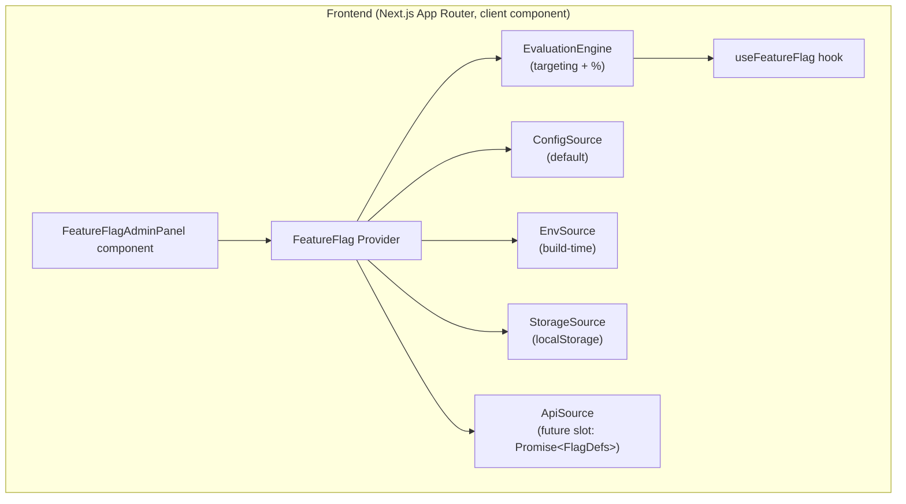
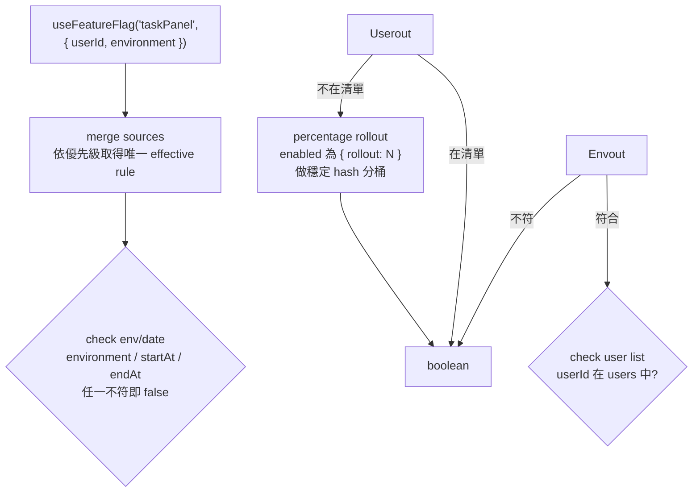

# Feature Flags 設計與實作

- **日期**: 2026-07-23
- **狀態**: 已實作完成
- **範圍**: Frontend-only（保留未來擴充至後端的介面）

## 背景與目標

本專案目前只有一個 Next.js 前端頁面（`frontend/app/page.tsx`），後端可在 FastAPI / Spring Boot 之間切換。為了在不頻繁部署的前提下安全地驗證新功能,需要一套前端 feature toggle 機制。

### 目標

- 支援 kill switch、preview/dev 功能、gradual rollout、A/B testing 四種場景。
- 前端可 runtime 調整開關,無需重新 build。
- 預留未來由後端統一管理 flags 的擴充點。
- 提供開發者/管理員可見的 UI 面板。

### 非目標

- 不替 FastAPI 或 Spring Boot 後端實作 feature toggle（本階段只處理前端）。
- 不引入第三方 feature flag 服務（如 LaunchDarkly、Unleash）。
- 不做跨裝置一致的 A/B 分桶（前端-only 的限制,未來由後端補上）。

## 整體架構



Tech Stack: Next.js 15 (App Router), React 18, TypeScript 5.5, Node.js built-in `node:test` + `tsx` 作為 engine 測試執行器。

## Global Constraints

- 範圍:Frontend-only,不動 FastAPI / Spring Boot 後端。
- 不引入第三方 feature flag 服務（LaunchDarkly、Unleash 等）。
- 不引入新測試框架;engine 單元測試使用 Node.js 內建 `node:test` + `tsx` 執行 TypeScript。
- 不更動 `page.tsx` 現有功能,只加入示範用法與 Admin Panel 入口。
- `key` 使用 `camelCase`,全專案唯一。
- Flag 不存在或評估異常時回傳 `false`（fail-closed）。
- Source 合併採「整個 rule 覆蓋」,不做欄位級 merge。
- `NEXT_PUBLIC_FEATURE_*` 只控制 `enabled`,其餘 targeting 欄位由 localStorage / API 控制。

## Flag 資料結構

```ts
// frontend/lib/feature-flags/types.ts
export type FlagValue = boolean | { rollout: number }; // percentage: 0-100

export interface FlagRule {
  enabled: FlagValue;
  users?: string[];          // 特定 userId 清單
  environments?: string[];   // e.g. ["development", "preview"]
  startAt?: string;          // ISO 8601 date
  endAt?: string;            // ISO 8601 date
}

export interface FeatureFlagDefinition {
  key: string;
  name: string;
  description?: string;
  defaultRule: FlagRule;
}

export interface FeatureFlagContext {
  userId?: string;
  environment?: "development" | "preview" | "production";
}

export type FeatureFlagOverrideMap = Record<string, FlagRule | undefined>;

export type { FlagSource } from "./sources/types";
```

設計原則:

- `key` 使用 `camelCase`,全專案唯一。
- `enabled` 可以是純 boolean,也可以是 `{ rollout: number }`。
- `users`、`environments`、`startAt`、`endAt` 同時存在時為 AND 關係。
- Flag key 不存在時一律回傳 `false`（fail-closed,適合 kill switch）。

## 預設 Flags

```ts
// frontend/lib/feature-flags/default-flags.ts
import type { FeatureFlagDefinition } from "./types";

export const DEFAULT_FLAGS: FeatureFlagDefinition[] = [
  {
    key: "taskPanel",
    name: "Task Panel",
    description: "在聊天介面顯示背景任務面板",
    defaultRule: { enabled: false }
  },
  {
    key: "streamingResponse",
    name: "Streaming Response",
    description: "使用 SSE 串流回應",
    defaultRule: { enabled: true }
  },
  {
    key: "newBackendToggle",
    name: "New Backend Toggle",
    description: "測試後端切換 UI 的實驗性改版",
    defaultRule: { enabled: { rollout: 0 }, environments: ["development"] }
  }
];

export const DEFAULT_FLAG_KEYS = DEFAULT_FLAGS.map((f) => f.key);
```

## Source 優先級與 Fallback

由低到高:

1. **ConfigSource**: `lib/feature-flags/default-flags.ts` 中的預設值。
2. **EnvSource**: `process.env.NEXT_PUBLIC_FEATURE_*` build-time 環境變數。
3. **StorageSource**: `localStorage` 中的 override。
4. **ApiSource**（未來）: 從後端 API 抓取,本階段只保留介面。

合併時,高優先級 source 的 rule 會完全覆蓋低優先級的 rule（不採用欄位級 merge,避免語意混淆）。

### 環境變數格式

EnvSource 只負責控制 `enabled` 欄位,格式如下:

- `NEXT_PUBLIC_FEATURE_<UPPER_SNAKE_KEY>=true` → `enabled: true`
- `NEXT_PUBLIC_FEATURE_<UPPER_SNAKE_KEY>=false` → `enabled: false`
- `NEXT_PUBLIC_FEATURE_<UPPER_SNAKE_KEY>=rollout:<N>` → `enabled: { rollout: N }`

例如 `taskPanel` 對應 `NEXT_PUBLIC_FEATURE_TASK_PANEL=true`。
其餘 targeting 欄位（`users`、`environments`、`startAt`、`endAt`）不在 env 層控制,預設繼承 ConfigSource 的對應欄位;若需要完整覆蓋,請使用 StorageSource 或未來的 ApiSource。

### localStorage 格式

StorageSource 使用單一 key `feature-flag-overrides`,值為 JSON:

```json
{
  "taskPanel": {
    "enabled": { "rollout": 30 },
    "users": ["u1", "u2"],
    "environments": ["development"]
  }
}
```

Admin panel 的修改會即時更新此 JSON。

## 評估引擎

### 流程



### Percentage Rollout

- 使用 `userId + flagKey` 做穩定 hash（FNV-1a）,結果落在 `[0, 99]`。
- `bucket < rollout` 則啟用。
- 若無 `userId`,則對 `flagKey` 單獨 hash（使用者每次重新整理可能不同,不建議用於 rollout）。

### 錯誤處理

- Source 載入或解析失敗時,忽略該 source 並繼續使用下一層。
- 評估過程中任何例外視為 `false`。
- localStorage 寫入失敗時只在 `console.warn` 提示,不中斷 UI。

## React API

```ts
// 最簡用法
const enabled = useFeatureFlag("taskPanel");

// 帶 context:用於 percentage rollout / user targeting
const enabled = useFeatureFlag("taskPanel", { userId, environment: "development" });

// 取得完整定義與生效 rule
const { enabled, definition, effectiveRule } = useFeatureFlagDetail("taskPanel");
```

### Provider 用法

```tsx
// app/layout.tsx
<FeatureFlagProvider context={{ userId, environment: "development" }}>
  {children}
</FeatureFlagProvider>
```

Provider 會在 mount 時初始化所有 source,並在 localStorage 變更時觸發重新評估。

## Admin Panel

- **位置**: 右上角的「Feature Flags」按鈕,點開後為深色面板。
- **顯示條件**: 預設隱藏,可透過以下任一方式開啟:
  - `localStorage.setItem("feature-flag-admin-enabled", "true")`
  - 環境變數 `NEXT_PUBLIC_FEATURE_FLAG_ADMIN=true`
- **內容**:
  - 列出所有 `DEFAULT_FLAGS` 的 key、name、description。
  - 顯示目前評估結果（true/false,綠/紅）與生效來源。
  - boolean toggle。
  - percentage slider（0-100）。
  - environment 與 user list 輸入（逗號分隔）。
  - 修改後立即寫入 localStorage,並透過 Provider state 通知所有 consumer 重新評估。

## 檔案結構與職責

```
frontend/
├── lib/feature-flags/
│   ├── types.ts
│   ├── default-flags.ts
│   ├── engine.ts
│   ├── engine.test.ts
│   ├── provider.tsx
│   ├── hooks.ts
│   ├── utils.ts
│   └── sources/
│       ├── types.ts
│       ├── config-source.ts
│       ├── env-source.ts
│       ├── storage-source.ts
│       └── api-source.ts
├── components/
│   └── feature-flag-admin-panel.tsx
├── app/
│   ├── layout.tsx       # 包 FeatureFlagProvider
│   └── page.tsx         # 示範用法 + Admin Panel 按按鈕
├── package.json         # 新增 devDependency: tsx
└── .env.example         # 新增 NEXT_PUBLIC_FEATURE_* 範例
```

| 檔案 | 職責 |
|---|---|
| `types.ts` | 所有型別定義 + `FlagSource` 重新匯出 |
| `default-flags.ts` | 預設 flag 定義,作為最後 fallback |
| `utils.ts` | `stableBucket`（FNV-1a）、`isFlagValueEnabled`、`isRuleActiveForEnvironment`、`isRuleActiveForDate` |
| `engine.ts` | 合併 sources 與評估邏輯,`evaluateFlag` |
| `engine.test.ts` | 9 個單元測試（boolean / user / env / date / merge / rollout / fail-closed / failing source） |
| `provider.tsx` | React Context、Provider、`evaluateFlagInContext` |
| `hooks.ts` | `useFeatureFlag`、`useFeatureFlagDetail` |
| `sources/types.ts` | `FlagSource` 介面 |
| `sources/config-source.ts` | 讀取 `default-flags.ts` |
| `sources/env-source.ts` | 解析 `NEXT_PUBLIC_FEATURE_*` |
| `sources/storage-source.ts` | 讀寫 `localStorage` |
| `sources/api-source.ts` | 未來 API 介面,目前回傳空 |
| `components/feature-flag-admin-panel.tsx` | Admin UI（深色主題） |

## 與現有程式碼整合

- 不刪除或重構 `page.tsx` 的現有功能。
- 在 `layout.tsx` 加入 `FeatureFlagProvider`。
- 在 `page.tsx`:
  ```tsx
  const showTaskPanel = useFeatureFlag("taskPanel", { userId, environment: "development" });
  ```
  並渲染 `<FeatureFlagAdminPanel />` 與 `{showTaskPanel && ...}` 示範區塊。
- Admin panel 以獨立 component 引入,不影響既有 UI 流程。

## 測試策略

### 單元測試

針對 `engine.ts` 建立測試,覆蓋 boolean enabled、`users` 清單匹配、percentage rollout 對同一 user 穩定、`environments` 與 `startAt` / `endAt` 過濾、source merge 優先級、不存在的 flag 回傳 `false`、錯誤情境回傳 `false`。

Run: `cd frontend && npx tsx --test lib/feature-flags/engine.test.ts`
Expected: 9/9 通過。

### 手動驗證

- 啟動 `npm run dev`。
- 預設看不到「Feature Flags」按鈕。
- 在 DevTools Console 執行 `localStorage.setItem('feature-flag-admin-enabled', 'true')` 後重新整理。
- 看到按鈕,點開後切換 `taskPanel` 的 boolean toggle,觀察示範區塊顯示/隱藏。
- 測試 `newBackendToggle` 的 percentage rollout,對不同 userId 觀察穩定性。

## 實作 Task 摘要

| Task | 內容 | 檢查 |
|---|---|---|
| 1 | 型別與預設 flags | `npx tsc --noEmit` |
| 2 | 通用工具函式（hash、日期、環境） | `npx tsc --noEmit` |
| 3 | Source 介面與四層實作 | `npx tsc --noEmit` |
| 4 | 評估引擎 + 單元測試 + `tsx` devDep | `npx tsx --test lib/feature-flags/engine.test.ts` |
| 5 | React Provider 與 Hooks | `npx tsc --noEmit` |
| 6 | Admin Panel 元件（深色主題） | `npx tsc --noEmit` |
| 7 | 整合進 Layout 與 Page | dev server 手動驗證 |
| 8 | `.env.example` 與文件更新 | `git status --short` |

本專案慣例不主動 commit;若使用者明確要求,才執行 `git add` + `git commit`。

## 未來擴充

- **後端統一管理**: 實作 `ApiSource.fetch()`,由 FastAPI 或 Spring Boot 提供 `/api/feature-flags`。
- **跨裝置一致**: 由後端根據 userId 計算 bucket 並快取。
- **事件追蹤**: 在 `useFeatureFlag` 中加入 `onEvaluated` callback,串接分析工具。
- **權限控管**: Admin panel 的顯示與寫入改由後端身份驗證決定。

## 決策記錄

| 決策 | 選擇 | 原因 |
|---|---|---|
| 範圍 | 前端-only | 使用者明確要求先處理前端,後續再擴充 |
| Source 優先級 | config < env < localStorage < API | 符合常見 feature flag 設計,且保留未來擴充彈性 |
| 分桶演算法 | FNV-1a(userId + flagKey) | 簡單、穩定、無額外依賴 |
| Fail-closed | 不存在或異常時回傳 false | 適合 kill switch,避免誤開功能 |
| Admin panel 顯示 | 預設隱藏 | 避免干擾一般使用者 |
| 不引入第三方服務 | 自建輕量 engine | 專案規模小,第三方過度設計 |

## 風險與注意事項

- **前端-only 限制**: A/B testing 與 rollout 只能保證同一瀏覽器一致,換裝置會不一致。
- **localStorage 安全性**: Admin panel 的 override 存在 client side,無法防止使用者自行修改;敏感功能不應僅靠前端 flag 保護。
- **Hydration**: Next.js App Router 中 Provider 與 hook 只在 client component 使用,需確保 `use client` 標記正確;admin 面板的 `localStorage` 讀取需放到 `useEffect`,避免 SSR/客戶端不一致。

> 已於 2026-07-23 實作完成。